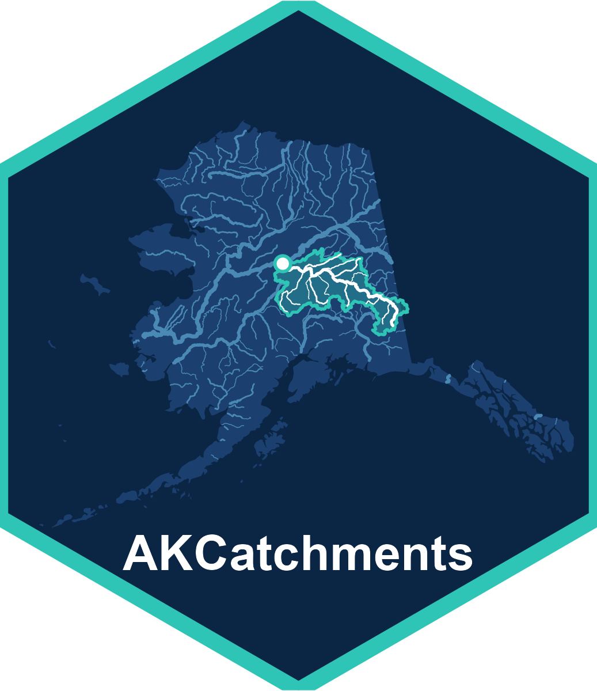

# AKCatchments 
This package is currently in alpha testing, but we're happy to have anybody 
attempt the workflows and contribute [Issues](https://github.com/AKRiversLab/AKCatchments/issues)!

AKCatchments is meant for generating catchment-scale information for streams in Alaska, 
where tools like StreamCat are currently underdeveloped (though are available in some locations!) compared
to the lower 48. This information should then be suitable (or at least evaluatable) for use in downstream
scientific analyses. Here's the conceptual workflow:

1) Delineate a catchment above any stream point in Alaska from a latitude and
longitude,
2) Check the result*, 
3) Summarise catchment attributes (topography, climate, fire, geology, soils, 
land cover, permafrost, alder, snow-off) with their uncertainty stated alongside 
each value.

*Every delineation is flagged by automatic checks and plotted on satellite
imagery with the DEM channels and a reference flowline network, so you can
see whether it makes sense before you use it.

## Installation

```r
# install.packages("remotes")
remotes::install_github("AKRiversLab/AKCatchments")

# WhiteboxTools does the flow routing; install its binary once
whitebox::install_whitebox()
```

Needs R 4.1 or later.

## Quick start

```r
library(AKCatchments)
ak_set_cache("D:/AKCatchments_cache", persist = "user")  # once: where downloads go (can reach tens of GB)

pts <- data.frame(site_code = c("LSR", "SITE-2"),
                  lat = c(61.7089, 63.7255), lon = c(-149.2267, -148.9670))

x <- ak_catchments(pts)                 # delineate, check, plot on imagery (progress bar per site)
x                                       # areas, delin_ok, flags; plots in catchment_plots/
attr(x, "errors")                       # sites that failed, and why

ak_layers()                             # what can be added: layer, source, what it returns, licence, ...
x <- x |>                               # one value per site: columns appended, with _se/_lo95/_hi95/_flag
  ak_topography() |>
  ak_outlet_slope() |>
  ak_landcover() |>
  ak_permafrost() |>                                # default: Jorgenson et al. 2008
  ak_permafrost(source = "pastick2015")             # an alternate, alongside

w <- ak_weather(x, years = 1990:2023)   # long tables are returned, not stored on x
ws <- weather_at_samples(w, samples)    # anomalies (vs the 1991-2020 daily normal) at each sample

ak_provenance(x)                        # per layer: product, citation, licence, download date, arguments
ak_write(x, "catchments.gpkg", weather = w, samples = ws)   # polygons + attributes, provenance, errors, tables
```

- Any column of `pts` named like an `ak_delineate()` argument
  (`ref_area_km2`, `snap_dist_m`, `dem_source`, ...) applies to that site
  only, so per-site corrections live in the table.
- Layer functions work on any sf polygons with a unique `site_code`, such
  as hand-drawn catchments; `import_catchments()` brings those in and
  prepares their DEM for the terrain functions.
- `ak_prefetch(x)` downloads everything the layers need first (before a long
  run, before going offline, or to fill a shared cache). The RGI glaciers
  need a free Earthdata Login in a `.netrc` file (`vignette("data-sources")`).
- `ak_citations(x)` gives the references, terms of use and acknowledgements
  for every layer on `x`, and writes them to a BibTeX file.
- Parallel: start mirai daemons (`mirai::daemons(4)`) and the per-site
  loops use them; `ak_catchments(regional = TRUE)` shares one DEM window
  between nearby sites. See `?ak_parallel` and `vignette("workflow")`.

## The download cache

Every download goes into one cache folder, so nothing is fetched twice. Point
it anywhere, including a shared folder that a group syncs (Box Drive, OneDrive,
a network drive):

```r
ak_set_cache("C:/Users/<you>/Box/CAKN/geo_database", persist = "user")  # writes AKCATCHMENTS_CACHE to ~/.Renviron
ak_cache_info()     # what's there: folder sizes and a manifest of every download (URL, size, date)
ak_cache_layout()   # which sub-folder holds which dataset
```

The folder is taken from `options(AKCatchments.cache = )`, else the
`AKCATCHMENTS_CACHE` environment variable. There is no default: until you
set one, functions that download stop and say how. Scratch files go to R's
session temp folder and are removed when R closes. Files are
written under a temporary `.part` name and renamed when complete, so a sync
client never uploads half a file. With Box Drive, mark the folder "Make
available offline", and check your plan's per-file limit before caching
TDX-Hydro (files of several GB).

The sub-folders use the same names as the AKSynthesis_RawGeoData workflow:
`scratch/daymet_pixels`, `modis_snow`, `ak_geology`, `accs_alnus`,
`nlcd_2016_ak`, `jorgenson_2008`, `dem` and `fire_history_ak.gpkg`. Point the
cache at that folder, or a copy of it, and the existing downloads are reused:
- Daymet pixel files whose years cover the request;
- MODIS crops that cover the catchments;
- the unpacked geology, alder and NLCD files;
- the fire perimeters.


## Delineate a point

```r
library(AKCatchments)

d <- ak_delineate(lat = 63.7255, lon = -148.9670, site_code = "SITE-001",
                  plot_dir = "delineation_plots")
d             # area, DEM used, snap distance, delin_ok, flags, plot path
d$catchment   # one-row sf polygon (EPSG:3338) with diagnostics and flags

# Many points at once; failures are recorded, not fatal
x <- ak_catchments(pts, plot_dir = "delineation_plots")
attr(x, "errors")
```

What happens:

1. **DEM.** `dem_source = "ifsar"` (default) pulls the Alaska IfSAR 5 m
   terrain model from the DGGS image service. `"copernicus"` uses Copernicus
   GLO-30; `"local"` reads your own tiles; `"elevatr"` is a last resort.
2. **Conditioning.** Least-cost depression breaching, D8 flow directions
   and accumulation (WhiteboxTools).
3. **Snapping.** The point moves to a channel cell within `snap_dist_m`
   (150 m). With a known area (`ref_area_km2`) it goes to the cell whose
   contributing area matches best; otherwise to the largest channel in reach
   (`snap = "largest"`) or the nearest (`snap = "nearest"`).
4. **Window growth.** If the catchment touches the edge of the DEM window,
   the window doubles (coarsening the cell size for very large basins) and
   the delineation is repeated. Running into missing elevation data is
   flagged instead (`nodata_edge`), since a bigger window can't fix it.
   A point with no elevation data at all (outside Alaska, offshore, lat and
   lon swapped) stops with a message saying so.
5. **Checks** (`?delineation_flags`):

| flag | type | meaning |
|---|---|---|
| `truncated` | fail | catchment still touches the window edge at `max_buffer_m` |
| `nodata_edge` | fail | catchment runs into cells without elevation data (edge of the DEM's coverage, e.g. the Canadian border for IfSAR): try `dem_source = "copernicus"` |
| `no_channel` | fail | no channel cell within the snap radius |
| `area_mismatch` | fail | area more than 1.5x off `ref_area_km2` |
| `multipart` | fail | polygon in separate pieces (pieces touching at a corner, as D8 cells do, count as one) |
| `tiny` | fail | under 0.05 km2 |
| `snap_at_limit` | warn | snapped at 90% or more of the search radius |
| `snap_conflict` | warn | with `snap = "consensus"`: the reference network's area fits a channel other than the one the flow path chose |
| `snap_ambiguous` | warn | another channel in reach differs in contributing area by more than 25% (e.g. the other side of a confluence); its area is in `snap_alt_area_km2` |
| `snap_off_stream` | warn | by the D8 flow paths, the snapped outlet is not on the sample point's stream |
| `dem_fallback` | warn | the first DEM failed and `fallback_dem` was used |
| `low_relief` | warn | over 30% flat cells or under 50 m of relief |
| `flowline_far` | warn | outlet more than 100 m from the reference flowlines |
| `flowline_crossings` | warn | reference flowlines cross the divide |

   `delin_ok` is `FALSE` if any fail flag is set. Warnings mean look at the
   plot.
   `vignette("delineation")` explains each step, which DEM is used
   when, and the usual pitfalls.
6. **Plot** (`plot_catchment()`): catchment, DEM channels, reference
   flowlines, sample point and snapped outlet over Esri World Imagery. Falls
   back to a hillshade if imagery can't be fetched.

### Where it works and where it doesn't

D8 routing on a 5 m DEM is reliable in upland, incised terrain. Expect
problems on braided or glacial outwash rivers, low-relief wetland and lake
lowlands (Yukon Flats, Copper River Basin floor, coastal plain), and
anywhere the DEM channel is displaced from the real stream. The
`low_relief`, `flowline_far` and `flowline_crossings` flags are the signals
that a site is outside the comfortable zone. For those sites, use a
hand-drawn or published polygon and record that you did.

## Reference flowlines

```r
ak_flowline_sources()   # what's available and how to get it

# Web services, queried for the area
fl <- ak_flowlines(d$catchment, source = "3dhp")   # USGS 3D Hydrography Program
fl <- ak_flowlines(d$catchment, source = "nhd")    # NHD (legacy)

# Global datasets: the files covering the area are downloaded once, then read from the cache
ak_download_flowlines(d$catchment, source = "tdx", download = FALSE)  # which files, from where
ak_download_flowlines(d$catchment, source = "tdx")    # TDX-Hydro (NGA, 12 m TanDEM-X)
ak_download_flowlines(d$catchment, source = "merit")  # MERIT-Basins (90 m; channels from 25 km2)
fl <- ak_flowlines(d$catchment, source = "tdx")       # downloads if needed, then reads
fl <- ak_flowlines(d$catchment, source = "merit")
fl <- ak_flowlines(d$catchment, source = "hydrorivers")

fl <- ak_flowlines(d$catchment, source = "file", path = "my_streams.gpkg")
```

Files are chosen with the HydroBASINS level-2 units (Alaska spans the North
America and Arctic regions). TDX-Hydro files run from hundreds of MB to
several GB per unit, so set `options(AKCatchments.cache = ...)` to a drive with
room. Licences differ: TDX-Hydro is CC BY-SA 4.0, and MERIT-Basins is
CC BY-NC-SA 4.0 (non-commercial). MERIT-Basins comes from the mghydro.com
mirror, because the official copy (Google Drive or Globus) can't be
downloaded by script.

`ak_delineate(flowlines = ...)` takes any of these names, an sf object, or
`NULL`.

## Reference polygons and validation

How well delineation and the flags do across Alaska, against published
USGS drainage areas and USGS StreamStats basins (Cook Inlet Basin), is
reported in the package paper; the package does not run a validation.

To check your own sites against reference polygons, such as hand-drawn
catchments, StreamStats (`ak_streamstats()`, Cook Inlet Basin only) or the
USGS gaged basins (`ak_gaged_basins()`), use `compare_catchments()`:

```r
x    <- ak_catchments(read.csv("sites.csv"))     # site_code, lat, lon
hand <- sf::read_sf("hand_delineations.gpkg")    # site_code + polygons
compare_catchments(x, hand)   # area ratio, IoU, shares inside each other, Hausdorff, agree
```

`ak_gaged_basins()` downloads the USGS basin boundaries for Alaska
streamgages through 2019, a third reference independent of your own sites.

`compare_catchments(a, b)` does the pairwise comparison on its own.
Measures: area ratio, intersection over union (IoU), the share of each
polygon inside the other, and Hausdorff distance. `agree` means IoU ≥ 0.8
and areas within a factor of 1.25. Those thresholds are judgement calls;
report the continuous measures.

## Catchment attributes, by theme

Every layer function takes catchments as its first argument: sf polygons
with `site_code`, one row per catchment, in any CRS; a single
`ak_delineate()` result, a list of them, `ak_catchments()` or
`import_catchments()` output, or your own polygons. It crops its dataset to
the catchments. One value per site: the columns, with uncertainty columns
(`_se`, `_lo95`, `_hi95`, `_flag`) next to the values, are appended to the
catchments you pass in, with a provenance row. A long table (by day, year,
model or sample): returned as a table with its own provenance, to
summarise and add with `catchment_join()` or write alongside with
`ak_write()`. Each dataset has a vignette: how to download it, use it, how
its uncertainty is computed, how to check it, and its pitfalls.

| theme | dataset | function (`source`) | returns | vignette |
|---|---|---|---|---|
| Terrain | delineation DEM (IfSAR 5 m, Copernicus 30 m) | `ak_topography()`, `ak_outlet_slope()` | columns | `vignette("topography")` |
| Vegetation | ACCS *Alnus* foliar cover | `ak_alder()` (`"accs2021"`) | columns | `vignette("alder-accs")` |
| Vegetation | NPS Wrangell-St. Elias land cover (alder) | `ak_alder(source = "nps_wrst")` | columns | `vignette("alder-wrst")` |
| Vegetation | NLCD 2016 Alaska | `ak_landcover()` (`"nlcd2016"`) | columns | `vignette("landcover-nlcd")` |
| Vegetation | Landsat annual peak NDVI | `ak_peak_ndvi()`, then `peak_ndvi_summary()` | table, then one row per site | `vignette("greenness-landsat")` |
| Permafrost and ice | Jorgenson et al. 2008 extent and ground ice | `ak_permafrost()` (`"jorgenson2008"`) | columns | `vignette("permafrost-jorgenson")` |
| Permafrost and ice | Pastick et al. 2015 near-surface probability | `ak_permafrost(source = "pastick2015")` | columns | `vignette("permafrost-pastick")` |
| Permafrost and ice | Randolph Glacier Inventory 7.0 | `ak_glaciers()` | columns | `vignette("glaciers-rgi")` |
| Geology and soils | USGS SIM 3340 geologic map | `ak_geology()` | columns | `vignette("geology-sim3340")` |
| Geology and soils | Rock N, S and major oxides (Olson & Hawkins lithology geochemistry on SIM 3340) | `ak_rock_chem()` (`"olson2014"`) | columns | `vignette("rock-chemistry")` |
| Geology and soils | STATSGO2 (Soil Data Access) | `ak_soils()` | columns | `vignette("soils-statsgo")` |
| Disturbance | BLM AFS fire perimeters | `ak_fire()`; `by_year = TRUE` or `samples =` for tables | columns or table | `vignette("fire-afs")` |
| Climate and weather | PRISM 1981-2010 normals | `ak_climate_normals()` (`"prism8110"`) | columns | `vignette("climate-prism")` |
| Climate and weather | Daymet V4 daily weather | `ak_weather()`; then `weather_at_samples()` (anomalies, melt, degree days) and `ak_climate_normals(source = "daymet4")` | table; table; columns | `vignette("weather-daymet")` |
| Climate and weather | SNAP downscaled CMIP6 projections | `ak_climate_projection()` (`"snap_cmip6_4km"`), then `projection_ensemble()` | table, then one row per site (`wide = TRUE`) | `vignette("projections-snap")` |
| Snow | MODIS snow-off, filled from Daymet | `ak_snowoff()` | table | `vignette("snowoff-modis")` |
| Observations | AKTEMP-VIZ stream temperature, USGS daily values, your own data | `ak_obs_*()` | linked, not cropped | `vignette("observations")` |

Every layer also has a `_flag` column saying when to distrust a value: for
example partial map coverage, a catchment too small for the map, or
positional error dominating. All simulations use 500 draws by default.
`attribute_reliability()` compares each variable's error with its spread across
sites. `vignette("uncertainty")` covers what all layers share: reading the
columns, aggregating map error to a catchment, how the uncertainty carries
into the observations you join it to, and the alternatives at a glance.

General tools for any map:

- `catchment_class_shares()`: class percentages from a raster or polygon
  map, with the mapped share of the catchment, appended as columns.
- `catchment_mean()`: area-weighted mean of a continuous raster, appended.
- `positional_uncertainty()`: shifts each catchment at random by a
  normal error with SD `sigma_m` against the map and reports the spread of
  the class shares. Use it for coarse maps where boundary placement
  matters.
- `adjust_class_shares()`: error-adjusted class shares from an accuracy
  assessment's error matrix (Olofsson et al. 2014).
- `polygon_spread()`: runs any layer function on alternative polygons for
  the same sites (hand-drawn, automated, StreamStats) and reports the
  spread, so delineation error can be shown next to map error.

## Observations

Stream temperature, discharge, water chemistry and other observations are
not catchment layers. They share one long schema (`ak_obs_schema()`: dataset,
provider, station, coordinates, date or time, variable, value, unit,
qualifier, method, depth, source, retrieval date), so your own data and the
public records line up:

```r
st  <- ak_obs_temperature_stations()            # AKTEMP-VIZ: AKTEMP, USGS and NPS stream temperature
tmp <- ak_obs_temperature(st[1:3, ])            # daily water (and ERA5-Land air) temperature
gs  <- ak_obs_usgs_stations(x)                  # USGS stream sites with daily discharge/temperature (dataRetrieval)
q   <- ak_obs_usgs_daily(gs, "00060", dates = c("2015-01-01", "2024-12-31"))

chem <- ak_obs_read("chemistry.csv", dataset = "my chemistry", provider = "me", station_id = site,
                    date = as.Date(date), variable = analyte, value = result, unit = units)

ak_obs_link(x, gs)    # which stations are at each outlet, inside (with their share of the area), or near
```

The USGS functions use the Water Data APIs through dataRetrieval's
`read_waterdata_*` functions, not the NWIS services USGS is retiring.

## Sources

`ak_layers(details = TRUE)` returns the full registry: product, citation, URL, licence,
scale, published error, the columns that carry uncertainty, how it is
computed, and the assumptions. **Cite the underlying datasets**, not only this
package! `ak_citations(x)` lists the references for the layers you used, and
`vignette("data-sources")` sets out each provider's terms of use.

## Status

Version 0.2.0.9000 (development). The delineation, flagging, plotting,
comparison, catalog, observation-schema and uncertainty code is covered by
offline tests on a synthetic DEM. The functions that call web services
(IfSAR, Copernicus, 3DHP/NHD, StreamStats, AKTEMP-VIZ, alder and NLCD
downloads, Daymet, MODIS, Soil Data Access, USGS geology and Water Data,
PRISM, Pastick, gaged basins) are written to the services' documented
interfaces but haven't yet been run end to end against them. Expect the
first real runs to turn up endpoint details to fix.

### Live tests

`inst/live-tests/ak_live_tests.R` runs every downloading function against
the real services in one go, checks the results against known values (the
published drainage area of USGS 15290000, the USGS gaged-basin boundary,
StreamStats, plausible ranges), and writes `ak_live_test_report.md`, a
report to paste back when something fails. Run it in a fresh R session:

```r
file.copy(system.file("live-tests", "ak_live_tests.R", package = "AKCatchments"), ".")
source("ak_live_tests.R")   # LEVEL "quick" (default) or "full", set at the top
```

## Licence

MIT for the code. Each dataset keeps its own licence and citation; see
`ak_layers(details = TRUE)`.

## AI use

AI use in this project follows the [CRASR AI-use policy](https://github.com/CRASR/ai-use); the record is in `ai-use/`.
